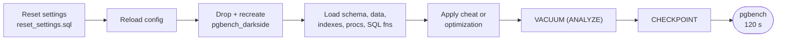

<div align="center">

# My Dishonest Benchmark

**How to make PostgreSQL 621× faster without making it any faster.**

A reproducible pgbench experiment that walks from a slow, honest workload to a jaw-dropping headline number,
one cheat at a time, and shows exactly which steps are real engineering and which are just marketing.

[](https://www.postgresql.org/)
[](https://www.postgresql.org/docs/current/pgbench.html)
[](runners/)
[](runners_linux/)
[](#the-20-cases)
[](../LICENSE)

[**Slides (PDF)**](My_Dishonest_Benchmark.pdf) ·
[**Run a single test by hand**](HOW_TO_RUN.md) ·
[**Full results report**](test_reports/20261010_pg18_devdrive_r1/REPORT.md)


</div>

---

## The punchline

PostgreSQL 18.6 on a Windows Dev Drive, `pgbench -c 32 -j 8 -T 120`, full reset before every run:

| Step | What changed | Reported | vs Case 0 | Honest? |
| --- | --- | ---: | ---: | :---: |
| **Case 0** | Bad code, missing index | 584 TPS | 1× | ✅ |
| **Indexed baseline** | Add the missing index | 22,705 TPS | **38.9×** | ✅ |
| **All durability off** | `fsync`, `full_page_writes`, `synchronous_commit` = off | 24,666 TPS | 42.2× | ❌ |
| **SQL function + prepared** | Move the logic server-side, prepare the statements | 80,178 TPS | **137×** | ✅ |
| **Batch ×32** | Count 32 rows per transaction as 32 "operations" | 269,617 ops/s | 462× | 📏 |
| **Grand finale** | All cheats + batch ×32 in an SQL function | **362,789 ops/s** | **621×** | ❌ |

> [!IMPORTANT]
> The grand finale's **621×** headline is only **11,337 real business transactions per second**,
> about **7× fewer** than the honest SQL function + prepared result (80,178 TPS).
> The big number comes from changing the unit and turning off durability, not from a faster database.

**Takeaways**

- 🔍 **The missing index is the biggest honest win**: 38.9× from one `CREATE INDEX`.
- 🧠 **Server-side code is the biggest honest single-row win**: stored procedure and SQL function both give ~3.2–3.5× over the indexed baseline.
- 🎭 **Durability cheats look small on Windows** (~1.07–1.09×), because the default `open_datasync` already gets commits acknowledged from the SSD cache. See [Things that change the numbers](#things-that-change-the-numbers).
- 📏 **Batching mostly changes the unit of measurement**: ops/s goes up, real TPS goes down.

<details>
<summary><strong>More charts</strong></summary>

<br>

| Step 1: the missing index | Honest units: business TPS |
| :---: | :---: |
|  |  |
| **Operations per second** | **Average latency** |
|  |  |

All 20 rows: [`results_table_all20.png`](test_reports/20261010_pg18_devdrive_r1/charts/results_table_all20.png) ·
raw numbers: [`results_round1.csv`](test_reports/20261010_pg18_devdrive_r1/pg18/results_round1.csv)

</details>

> [!CAUTION]
> This benchmark **intentionally** uses unsafe settings such as `fsync = off`, `full_page_writes = off`
> and `synchronous_commit = off`. They make the numbers look better but break PostgreSQL's durability
> guarantees, so a crash can lose or corrupt data. Never use them in production. That is the point of the benchmark.

---

## Contents

- [Quick start](#quick-start)
- [Benchmark environment](#benchmark-environment)
- [Test protocol](#test-protocol)
- [The 20 cases](#the-20-cases)
- [Reading the results](#reading-the-results)
- [Running on Linux (Ubuntu)](#running-on-linux-ubuntu)
- [Dev Drive](#dev-drive)
- [Windows Defender and TPS swings](#windows-defender-and-tps-swings)
- [Things that change the numbers](#things-that-change-the-numbers)
- [What this repo contains](#what-this-repo-contains)

---

## Quick start

> [!TIP]
> Just want one test? [HOW_TO_RUN.md](HOW_TO_RUN.md) has plain `psql` + `pgbench` commands for every case,
> and `simple_tests/` has one ready-made 2-minute script per test.

**Windows (PowerShell)**

```powershell
$env:PGPASSWORD = '********'
psql -h localhost -U postgres -d postgres -f reset_settings.sql
Restart-Service postgresql-x64-18 -Force
pwsh runners/run_all.ps1
```

**Linux (bash)**

```bash
export PGPASSWORD=********
sudo -u postgres psql -f reset_settings.sql
sudo systemctl restart postgresql@18-main
bash runners_linux/run_all.sh          # quick smoke test: DUR=5 WARM=2 bash runners_linux/run_all.sh
```

The full suite is about 20 × 2 minutes of measurement plus a reset before every run. Results go to `results_final.csv`.

```text
run_all  ──►  run_final  ──►  run_sqlfn  ──►  run_sqlfn_finale
```

> [!NOTE]
> Paths inside the Windows scripts point to the original `...\dishonest_benchmark` folder.
> Adjust them before running on another machine.

---

## Benchmark environment

| Area | Value |
| --- | --- |
| Host | Intel Core i7-13700, 16 cores / 24 threads |
| RAM | 63.8 GB |
| Storage | Samsung SSD 980 NVMe |
| OS | Windows 11 |
| Database | PostgreSQL 18.4, x86_64 |
| Driver | pgbench 18.4 |
| Test duration | 120 seconds per measured test |
| Load | 32 clients / 8 threads |
| Database name | `pgbench_darkside` |
| Connection | `-h localhost -U postgres -d pgbench_darkside` |
| Password source | `PGPASSWORD=*******` |
| Dataset | 100 branches, 1,000,000 accounts |
| Audit seed | 200,000 recent rows in `bench_audit` |

The [Dev Drive report](test_reports/20261010_pg18_devdrive_r1/REPORT.md) was run on PostgreSQL 18.6 on the same host; its exact environment and settings are listed there.

---

## Test protocol

Every measured run starts from identical conditions:



<details>
<summary><strong>Exact reset commands</strong></summary>

```powershell
psql -d postgres -c "DROP DATABASE IF EXISTS pgbench_darkside WITH (FORCE);"
psql -d postgres -c "CREATE DATABASE pgbench_darkside;"

psql -d pgbench_darkside -f sql/schema_load.sql
psql -d pgbench_darkside -f sql/setup_objects.sql
psql -d pgbench_darkside -f sql/create_sqlfn.sql

psql -d pgbench_darkside -c "VACUUM (ANALYZE);"
psql -d pgbench_darkside -c "CHECKPOINT;"
```

Restart-only parameters were applied once through `ALTER SYSTEM`, followed by a service restart:

```powershell
Restart-Service postgresql-x64-18 -Force
```

The restart-only settings: `wal_buffers`, `io_workers`, `io_method`, `shared_buffers`, `max_connections`, `io_max_concurrency`.

One global warm-up was run before the full suite:

```powershell
pgbench -n -c 32 -j 8 -T 15 -f sql/honest-ish.sql -h localhost -U postgres -d pgbench_darkside
```

</details>

All measured commands share the same pgbench shape:

```text
pgbench -n -c 32 -j 8 -T 120 -M <simple|prepared> -f sql/<script>.sql -h localhost -U postgres -d pgbench_darkside
```

---

## The 20 cases

Legend: ✅ honest optimization · ❌ cheat (less safety or less work) · 📏 unit trick (batching) · 🚫 run but excluded from the blog/PDF

| # | Case | Script | `-M` | Kind |
| ---: | --- | --- | --- | :---: |
| 1 | Bad code / missing index | `honest-ish.sql` | simple | baseline |
| 2 | Indexed baseline | `honest-ish.sql` | simple | ✅ |
| 3 | `synchronous_commit = off` | `honest-ish.sql` | simple | ❌ |
| 4 | `full_page_writes = off` | `honest-ish.sql` | simple | ❌ |
| 5 | `fsync = off` | `honest-ish.sql` | simple | ❌ |
| 6 | Checkpoint tuning | `honest-ish.sql` | simple | ✅ |
| 7 | All durability off | `honest-ish.sql` | simple | ❌ |
| 8 | Less work: drop FK / SELECT / audit | `less_work.sql` | simple | ❌ |
| 9 | `UNLOGGED` ledger/audit | `unlogged.sql` | simple | ❌ |
| 10 | Stored procedure (PL/pgSQL) | `procedure.sql` | simple | ✅ |
| 11 | Prepared protocol | `honest-ish.sql` | prepared | ✅ |
| 12 | Prepared + pipelined | `honest-ish-pipeline.sql` | prepared | 🚫 |
| 13 | Batch ×8 | `batch.sql` | simple | 📏 |
| 14 | Batch ×32 | `batch32.sql` | simple | 📏 |
| 15 | Stored procedure + prepared | `procedure.sql` | prepared | ✅ |
| 16 | All cheats + batch ×32 | `batch32.sql` | prepared | ❌ 📏 |
| 17 | All cheats + mega-batch ×1000 | `megabatch.sql` | prepared | 🚫 |
| 18 | Stored function (`LANGUAGE sql`) | `sqlfunction.sql` | simple | ✅ |
| 19 | SQL function + prepared | `sqlfunction.sql` | prepared | ✅ |
| 20 | **Grand finale:** all cheats + batch ×32 SQL function | `batch32_sqlfn.sql` | prepared | ❌ 📏 |

Cases 12 and 17 were run during testing and are in `results_final.csv`, but are left out of the blog/PDF.
Case 17 deadlocks by design (111 failed transactions in the Dev Drive run).

### Pre-steps

Cases not listed here run the command with no pre-step.

<details>
<summary><strong>1. Bad code / missing index</strong></summary>

```sql
DROP INDEX IF EXISTS bench_audit_created_at_audit_id_idx;
DROP INDEX IF EXISTS ix_bench_audit_created;
```

</details>

<details>
<summary><strong>3–5. One durability setting off</strong></summary>

```sql
ALTER SYSTEM SET synchronous_commit = off;   -- case 3
ALTER SYSTEM SET full_page_writes = off;     -- case 4
ALTER SYSTEM SET fsync = off;                -- case 5
SELECT pg_reload_conf();
```

Each case applies only its own setting.

</details>

<details>
<summary><strong>6. Checkpoint tuning</strong></summary>

```sql
ALTER SYSTEM SET max_wal_size = '64GB';
ALTER SYSTEM SET checkpoint_timeout = '30min';
SELECT pg_reload_conf();
```

</details>

<details>
<summary><strong>7. All durability off</strong></summary>

```sql
ALTER SYSTEM SET synchronous_commit = off;
ALTER SYSTEM SET full_page_writes = off;
ALTER SYSTEM SET fsync = off;
SELECT pg_reload_conf();
```

</details>

<details>
<summary><strong>8. Less work: drop FK / SELECT / audit</strong></summary>

```sql
ALTER TABLE bench_accounts
DROP CONSTRAINT IF EXISTS bench_accounts_branch_id_fkey;
```

</details>

<details>
<summary><strong>16, 17, 20. All cheats</strong></summary>

```sql
ALTER SYSTEM SET synchronous_commit = off;
ALTER SYSTEM SET full_page_writes = off;
ALTER SYSTEM SET fsync = off;
ALTER SYSTEM SET max_wal_size = '64GB';
ALTER SYSTEM SET checkpoint_timeout = '30min';
SELECT pg_reload_conf();

ALTER TABLE bench_accounts
DROP CONSTRAINT IF EXISTS bench_accounts_branch_id_fkey;
```

</details>

Example, the grand finale (case 20):

```powershell
pgbench -n -c 32 -j 8 -T 120 -M prepared -f sql/batch32_sqlfn.sql -h localhost -U postgres -d pgbench_darkside
```

---

## Reading the results

```text
reported OPS = TPS × operations per transaction
```

| Test type | Ops per transaction | Reported metric |
| --- | :---: | --- |
| Non-batched tests | 1 | TPS |
| Batched tests | 8, 32 or 1000 | Operations per second |

> [!WARNING]
> A batched test's ops/s is **not** comparable with a non-batched test's TPS.
> Compare real TPS (business transactions per second) when you want the honest answer.


---

## Running on Linux (Ubuntu)

`runners_linux/` is a bash port of `runners/`. It runs the same tests with the same protocol, settings and CSV columns.
The SQL files are shared, so nothing under `sql/` is Linux-specific.

### 1. Install PostgreSQL 18 from the PGDG repository

Ubuntu's own packages ship an older major version. The baseline sets `io_method`, `io_workers` and `io_max_concurrency`, which exist only in PostgreSQL 18+.

```bash
sudo apt install -y postgresql-common
sudo /usr/share/postgresql-common/pgdg/apt.postgresql.org.sh
sudo apt install -y postgresql-18 postgresql-client-18
```

### 2. Set the password

The runners connect over TCP (`-h localhost`), which Ubuntu authenticates with `scram-sha-256`:

```bash
sudo -u postgres psql -c "ALTER USER postgres PASSWORD '*******';"
```

### 3. Apply the baseline and restart once

```bash
sudo -u postgres psql -f reset_settings.sql
sudo systemctl restart postgresql@18-main
```

`run_final.sh` warns if any restart-only setting is still pending (`pg_settings.pending_restart`).

### 4. Run the suite

From any directory:

```bash
bash runners_linux/run_all.sh
```

The chain is the same as on Windows (`run_all.sh` → `run_final.sh` → `run_sqlfn.sh` → `run_sqlfn_finale.sh`).
Results go to `results_final.csv` in the repo root. Every knob can be overridden through the environment:

| Variable | Default |
| --- | --- |
| `PGHOST` / `PGPORT` / `PGUSER` | `localhost` / `5432` / `postgres` |
| `PGPASSWORD` | `*******` |
| `BENCH_DB` | `pgbench_darkside` |
| `DUR` / `WARM` | `120` / `15` seconds |
| `CLIENTS` / `THREADS` | `32` / `8` |
| `RESULTS` | `<repo>/results_final.csv` |

For a quick smoke test: `DUR=5 WARM=2 bash runners_linux/run_all.sh`

### Comparability notes

- Set the CPU governor to `performance` before measuring: `sudo cpupower frequency-set -g performance`.
- The checkpoint-tuning and all-cheats cases allow `max_wal_size = 64GB`, so make sure `/var/lib/postgresql` has room.
- Linux and Windows flush WAL differently (`wal_sync_method` defaults differ), so durability-sensitive cases show different ratios. Compare Linux numbers only with Linux numbers.
- Keep the `.sh` files LF-only. `runners_linux/.gitattributes` enforces this on checkout. If you copy the folder from Windows by hand, run `sed -i 's/\r$//' runners_linux/*.sh`.

---

## Dev Drive

The PostgreSQL 18 runs in [`test_reports/20261010_pg18_devdrive_r1`](test_reports/20261010_pg18_devdrive_r1/REPORT.md) use a **trusted Dev Drive**: the binaries, the data directory and the WAL all live on `V:`.

<details>
<summary><strong>How it was created</strong></summary>

`V:` is a fixed-size 200 GB VHDX (`D:\devdrive\pgdev.vhdx`) formatted as a ReFS Dev Drive. To build the same volume (elevated PowerShell):

```powershell
@"
create vdisk file=D:\devdrive\pgdev.vhdx maximum=204800 type=fixed
attach vdisk
convert gpt
create partition primary
assign letter=V
"@ | diskpart

Format-Volume -DriveLetter V -DevDrive          # ReFS Dev Drive
fsutil devdrv trust V:                          # mark it trusted
fsutil devdrv query V:                          # expect "This is a trusted developer volume"
Set-MpPreference -PerformanceModeStatus Enabled # Defender performance mode
```

PostgreSQL 18 was then installed fresh into `V:\PostgreSQL\18`, with the data directory (and its `pg_wal`) at `V:\PostgreSQL\18\data`.

A VHDX attached with diskpart does not come back after a reboot. A startup scheduled task (`PgDevDrive-Attach`, runs as SYSTEM) re-attaches the VHDX and then starts the `postgresql-x64-18` service. Without it, PostgreSQL fails to start because `V:` does not exist yet.

</details>

### Why it matters for the numbers

On a normal NTFS volume, Defender real-time protection scans file operations **synchronously**, so a WAL write or a data-file write can wait for the scanner. On a trusted Dev Drive with performance mode on, Defender still scans, but **asynchronously**: file operations do not wait for the scan. Real-time protection stays on.

What this changes:

- Plain-SQL tests that already spend most of their time in PostgreSQL (the indexed baseline and the durability cheats) barely move.
- Short, commit-bound tests (stored procedure, SQL function, prepared protocol, batching and the finales) move a lot, because they do the most file operations per second and so wait on the scanner most often.
- Compare numbers only with numbers from the same storage setup. A Dev Drive result next to an NTFS `C:` result is a storage comparison, not a PostgreSQL one.

---

## Windows Defender and TPS swings

Before the Dev Drive, PostgreSQL ran from `C:` (NTFS) with Microsoft Defender real-time scanning on. Repeating the same test on the same install gave noticeably different TPS from run to run, with nothing changed in PostgreSQL. The commit-bound tests (stored procedure, SQL function, batching) swung the most, because every commit means WAL file operations that Defender inspects before letting them finish.

Adding Defender exclusions for the PostgreSQL files and process steadied the TPS:

```powershell
# Elevated PowerShell. Adjust the paths to your install.
Add-MpPreference -ExclusionPath    'C:\Program Files\PostgreSQL\18\data'
Add-MpPreference -ExclusionPath    'C:\Program Files\PostgreSQL\18\data\pg_wal'
Add-MpPreference -ExclusionProcess 'C:\Program Files\PostgreSQL\18\bin\postgres.exe'
```

Check that an exclusion is actually in effect:

```powershell
& "$env:ProgramFiles\Windows Defender\MpCmdRun.exe" -CheckExclusion -path 'C:\Program Files\PostgreSQL\18\data\pg_wal'
```

> [!WARNING]
> - On a centrally managed machine (Defender for Endpoint with Tamper Protection), local exclusions can be hidden from `Get-MpPreference` or overridden by policy. Use `MpCmdRun -CheckExclusion` to confirm, not `Get-MpPreference`.
> - An exclusion turns off scanning for those files. Use it only on a benchmark machine, not on a production server without your security team's approval.
> - A trusted Dev Drive with performance mode (see [Dev Drive](#dev-drive)) is the alternative that keeps real-time protection on.

---

## Things that change the numbers

### Windows: the default sync method

On Windows, PostgreSQL's default `wal_sync_method = open_datasync` lets the SSD acknowledge a commit while the data is still in its volatile RAM cache. On a consumer NVMe drive without power-loss protection, that costs about **38 µs** per commit, versus about **2 ms** for a real flush. As a result, the Windows "honest" baseline already skips most of the commit-flush cost, and the durability-off cheats look small there.

To make the durability cheats show their real impact, add this to the pre-step:

```powershell
psql -h localhost -U postgres -d postgres -c "ALTER SYSTEM SET wal_sync_method = fdatasync;" -c "SELECT pg_reload_conf();"
```

### Linux kernel settings

With `fsync = off`, the kernel decides when data reaches the disk. On a slow disk, the default dirty-page limits can stop throughput completely for several seconds at a time. Production-style settings:

```bash
sudo tee /etc/sysctl.d/99-postgresql.conf >/dev/null <<'EOF'
vm.overcommit_memory = 2
vm.overcommit_ratio = 100
vm.swappiness = 1
kernel.numa_balancing = 0
vm.dirty_background_ratio = 5
vm.dirty_ratio = 90
EOF
sudo sysctl -p /etc/sysctl.d/99-postgresql.conf
```

> [!NOTE]
> With `vm.overcommit_memory = 2`, a machine with **no swap** (typical for cloud VMs) may refuse to start PostgreSQL
> with `max_connections = 1000` and `shared_buffers = 1GB`. Add swap or lower those two settings.

### WSL2

WSL2 stores data on a virtual disk. Each real flush costs about 3 ms, and random 8 kB writes are slow, so the durability cheats look much bigger on WSL2 than on native hardware. Compare WSL2 numbers only with other WSL2 numbers.

### Dev Drive and Windows Defender

On Windows, where the PostgreSQL files live and how Defender scans them changes the commit-bound results a lot. See [Dev Drive](#dev-drive) and [Windows Defender and TPS swings](#windows-defender-and-tps-swings).

---

## What this repo contains

```text
dishonest_benchmark/
├── My_Dishonest_Benchmark.pdf / .pptx   slides
├── HOW_TO_RUN.md                        copy-paste commands for every case
├── reset_settings.sql                   honest baseline server configuration
├── sql/                                 schema, objects and the pgbench scripts
├── runners/                             PowerShell harness (Windows)
├── runners_linux/                       bash harness (Linux)
├── simple_tests/                        one 2-minute script per test (windows/, linux/)
└── test_reports/                        recorded runs, raw logs and charts
```

| Path | Purpose |
| --- | --- |
| `reset_settings.sql` | Restores the honest baseline server configuration using `ALTER SYSTEM` |
| `sql/schema_load.sql` | Creates tables, loads 1M accounts, seeds 200k audit rows, runs `VACUUM ANALYZE` and `CHECKPOINT` |
| `sql/setup_objects.sql` | Creates PL/pgSQL procedures such as `bench_txn` and `bench_txn_megabatch` |
| `sql/create_sqlfn.sql` | Creates the `LANGUAGE sql` functions used by the SQL-function tests |
| `sql/honest-ish.sql` | Indexed baseline transaction: read, update, two inserts, trim |
| `sql/less_work.sql` | Reduced-work variant: update + ledger insert only |
| `sql/unlogged.sql` | Writes to `UNLOGGED` ledger/audit tables |
| `sql/procedure.sql` | Calls `bench_txn(:aid, :delta)` through PL/pgSQL |
| `sql/honest-ish-pipeline.sql` | Pipelined variant, run but excluded from the blog/PDF |
| `sql/batch.sql` | 8 accounts per transaction using a client-side `IN` list |
| `sql/batch32.sql` | 32 accounts per transaction using a client-side `IN` list |
| `sql/sqlfunction.sql` | Calls `bench_txn_sqlfn(:aid, :delta)` |
| `sql/batch32_sqlfn.sql` | Calls `bench_txn_batch_sqlfn(...)` for a server-side batch |
| `sql/megabatch.sql` | Calls `bench_txn_megabatch(1000)`, run but excluded from the blog/PDF |
| `runners/*.ps1` | PowerShell harness that runs the benchmark suite (Windows) |
| `runners_linux/*.sh` | Bash port of the same harness for Linux (Ubuntu); shared helpers in `common.sh` |

---

<div align="center">

**Benchmarks don't lie. People choosing the unit, the settings and the baseline do.**

<sub>MIT licensed · see the <a href="My_Dishonest_Benchmark.pdf">slides</a> for the full story</sub>

</div>
