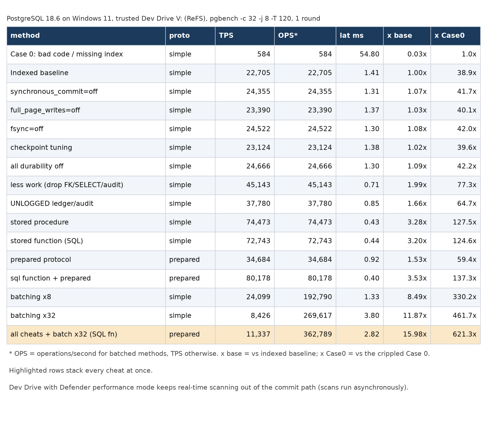
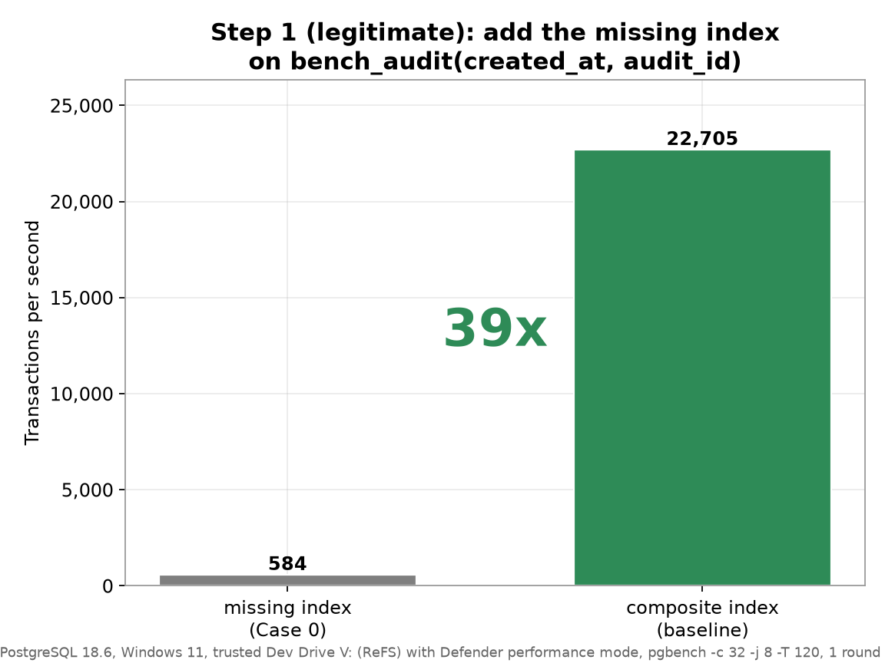
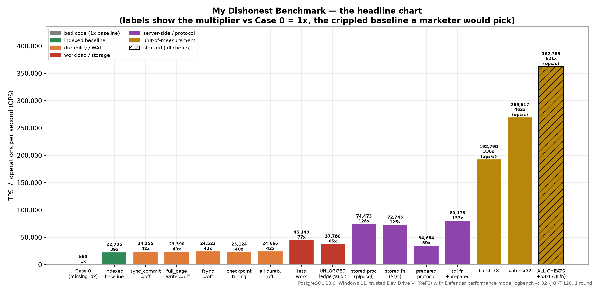
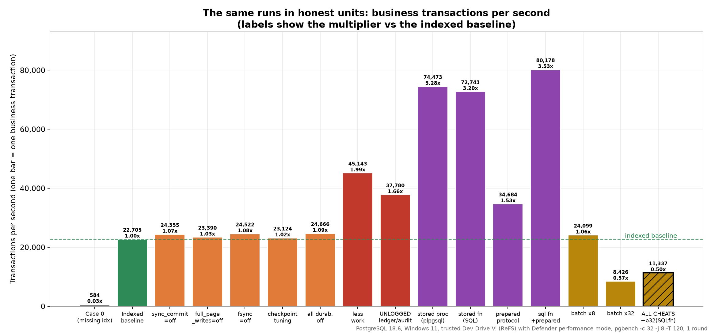
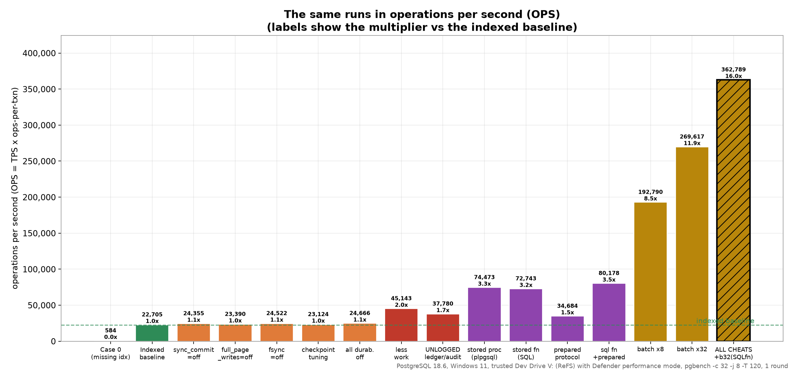
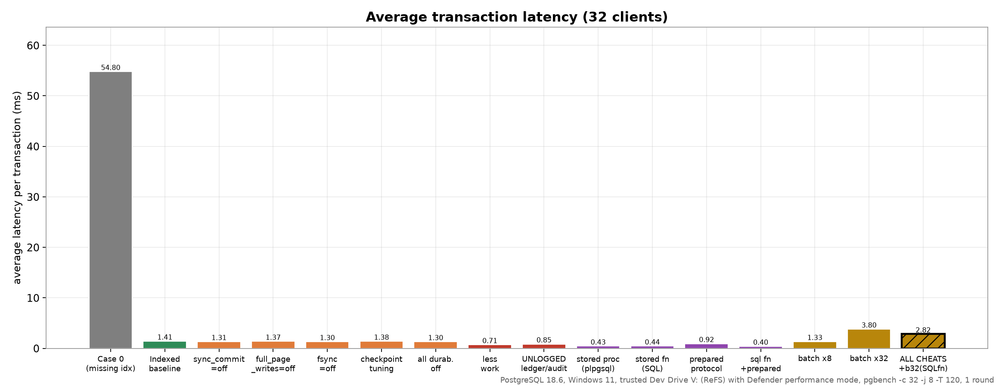
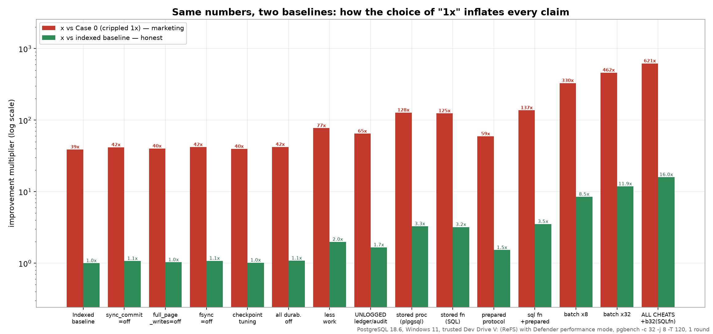

# Dishonest Benchmark: PostgreSQL 18 on a Windows Dev Drive

All 20 tests of the suite, run once (one round) on PostgreSQL 18.6 installed on a trusted Dev Drive, with a full reset before every run. Run date: 2026-10-10, 16:18 to 17:02.

## Key findings

| # | Finding | Evidence |
| --- | --- | --- |
| 1 | The missing index is the biggest honest win. | Case 0 584 TPS -> indexed 22,705 TPS (38.9x) |
| 2 | Durability cheats are small with the Windows default `open_datasync` (commits are acknowledged from the SSD cache). | all durability off 1.09x, synchronous_commit=off 1.07x, fsync=off 1.08x vs indexed |
| 3 | Server-side code is the largest honest single-row gain. | stored procedure 74,473 TPS (3.28x), stored function (SQL) 72,743 TPS (3.20x) |
| 4 | Best single-row (honest unit) result: sql function + prepared. | 80,178 TPS = 3.53x indexed |
| 5 | Batching only changes the unit of measurement. | batching x32 = 269,617 ops/s, but 8,426 real TPS |
| 6 | Grand finale (all cheats + batch x32 SQL fn) = the dishonest headline. | 362,789 ops/s = 621x Case 0, 16.0x indexed, while real TPS is 11,337 |
| 7 | Mega-batch x1000 deadlocks by design. | 111 failed transactions; 46,558 ops/s |

## 1. Why a Dev Drive with Defender performance mode

On a normal NTFS volume, Microsoft Defender real-time protection scans file operations synchronously. For PostgreSQL that means WAL and data-file writes can wait on the scanner, and the delay depends on what the scanner is doing at that moment. Short, commit-bound transactions (stored procedures, SQL functions, pipelining, batching) are the most exposed, so their TPS can change from run to run for reasons unrelated to PostgreSQL.

To keep the scanner out of the measurement, the whole PostgreSQL installation (binaries, data directory and WAL) is on a **trusted Dev Drive** with **Defender performance mode** enabled. In performance mode Defender still scans the Dev Drive, but asynchronously, so file operations do not wait for the scan. Real-time protection stays on.

| Item | State during the run |
| --- | --- |
| Volume | `V:`, ReFS Dev Drive, 200 GB fixed VHDX on `D:` (175 GB free) |
| Trust | `fsutil devdrv query V:`: "This is a trusted developer volume" |
| Antivirus filter | `WdFilter` attached (Defender still protects the volume) |
| Defender performance mode | Enabled with `Set-MpPreference -PerformanceModeStatus Enabled` (`Get-MpPreference` reports `PerformanceModeStatus : 1`) |
| Defender real-time protection | On (`RealTimeProtectionEnabled : True`, `IsTamperProtected : True`) |
| PostgreSQL install | `V:\PostgreSQL\18` (binaries), `V:\PostgreSQL\18\data` (data + WAL) |

## 2. Environment and protocol

| Item | Value |
| --- | --- |
| Host | Intel Core i7-13700 (16 cores / 24 threads), 63.8 GB RAM, Samsung SSD 980 NVMe |
| OS | Windows 11 Enterprise (26200) |
| PostgreSQL | PostgreSQL 18.6 on x86_64-windows, compiled by msvc-19.44.35229, 64-bit; fresh cluster, data checksums on, UTF8 |
| Commit sync | `wal_sync_method = open_datasync` (Windows default; acknowledged from the SSD write cache) |
| Load | `pgbench -n -c 32 -j 8 -T 120`, connection `-h localhost -U postgres` |
| Dataset | 100 branches, 1,000,000 accounts, 200,000 seeded audit rows |
| Other services | All SQL Server instances, pgbouncer, Veeam services, other PostgreSQL versions and WSL stopped; only PostgreSQL 18 running |
| Order | one round, tests 1-20, sequential (never parallel) |

Baseline settings (`reset_settings.sql`; full list in `pg18/settings.txt`):

| Setting | Value | Setting | Value |
| --- | --- | --- | --- |
| shared_buffers | 1 GB | wal_buffers | 64 MB |
| effective_cache_size | 6 GB | work_mem | 32 MB |
| maintenance_work_mem | 1 GB | max_connections | 1000 |
| max_wal_size / min_wal_size | 4 GB / 1 GB | checkpoint_timeout | 10 min |
| checkpoint_completion_target | 0.9 | wal_compression | lz4 |
| io_method / io_workers | worker / 10 | effective_io_concurrency | 256 |
| random_page_cost | 1.1 | default_statistics_target | 300 |
| jit | off | max_parallel_workers_per_gather | 0 |
| fsync / full_page_writes / synchronous_commit | on / on / on | | |

**Reset before every single run (20 runs in total):**

1. Re-apply the baseline (`reset_settings.sql`) and reload. Verify that `fsync`, `full_page_writes`, `synchronous_commit`, `max_wal_size` and `checkpoint_timeout` are back to baseline and that no setting is pending a restart; abort otherwise.
2. `DROP DATABASE pgbench_darkside WITH (FORCE)`, `CREATE DATABASE`.
3. `schema_load.sql`, `setup_objects.sql`, `create_sqlfn.sql`.
4. Drop the FK (tests 8, 16, 17, 20), `VACUUM (ANALYZE)`, then the test pre-step / cheat (verified from `pg_settings`).
5. `CHECKPOINT`, then the measured 120 s pgbench run.

Once at the start: empty `postgresql.auto.conf` + baseline, service restart (restart-only settings active, nothing pending), one 15 s warm-up. The original `postgresql.auto.conf` was restored afterwards.

## 3. All tests

Reported = TPS, or ops/s for batched tests (ops/s = TPS x ops per transaction).

| # | Test | Script | Protocol | Ops/txn | TPS | Reported (TPS or ops/s) | Latency ms | WAL/tx (B) | Txns | Failed txns | x vs indexed | x vs Case 0 |
| --- | --- | --- | --- | --- | --- | --- | --- | --- | --- | --- | --- | --- |
| 1 | Case 0: bad code / missing index | `honest-ish.sql` | simple | 1 | 584 | **584** | 54.801 | 987 | 69,949 | 0 | 0.03x | 1.0x |
| 2 | Indexed baseline | `honest-ish.sql` | simple | 1 | 22,705 | **22,705** | 1.409 | 595 | 2,721,146 | 0 | 1.00x | 38.9x |
| 3 | synchronous_commit=off | `honest-ish.sql` | simple | 1 | 24,355 | **24,355** | 1.314 | 594 | 2,916,656 | 0 | 1.07x | 41.7x |
| 4 | full_page_writes=off | `honest-ish.sql` | simple | 1 | 23,390 | **23,390** | 1.368 | 583 | 2,803,201 | 0 | 1.03x | 40.1x |
| 5 | fsync=off | `honest-ish.sql` | simple | 1 | 24,522 | **24,522** | 1.305 | 594 | 2,934,263 | 0 | 1.08x | 42.0x |
| 6 | checkpoint tuning | `honest-ish.sql` | simple | 1 | 23,124 | **23,124** | 1.384 | 595 | 2,769,484 | 0 | 1.02x | 39.6x |
| 7 | all durability off | `honest-ish.sql` | simple | 1 | 24,666 | **24,666** | 1.297 | 583 | 2,954,013 | 0 | 1.09x | 42.2x |
| 8 | less work (drop FK/SELECT/audit) | `less_work.sql` | simple | 1 | 45,143 | **45,143** | 0.709 | 341 | 5,406,128 | 0 | 1.99x | 77.3x |
| 9 | UNLOGGED ledger/audit | `unlogged.sql` | simple | 1 | 37,780 | **37,780** | 0.847 | 188 | 4,517,161 | 0 | 1.66x | 64.7x |
| 10 | stored procedure | `procedure.sql` | simple | 1 | 74,473 | **74,473** | 0.430 | 606 | 8,925,347 | 0 | 3.28x | 127.5x |
| 11 | prepared protocol | `honest-ish.sql` | prepared | 1 | 34,684 | **34,684** | 0.923 | 600 | 4,157,099 | 0 | 1.53x | 59.4x |
| 12 | prepared + pipelined | `honest-ish-pipeline.sql` | prepared | 1 | 76,176 | **76,176** | 0.420 | 604 | 9,117,178 | 0 | 3.35x | 130.5x |
| 13 | batching x8 | `batch.sql` | simple | 8 | 24,099 | **192,790** | 1.328 | 4,138 | 2,886,827 | 0 | 8.49x | 330.2x |
| 14 | batching x32 | `batch32.sql` | simple | 32 | 8,426 | **269,617** | 3.798 | 19,226 | 1,009,251 | 0 | 11.87x | 461.7x |
| 15 | stored proc + prepared | `procedure.sql` | prepared | 1 | 77,678 | **77,678** | 0.412 | 604 | 9,295,540 | 0 | 3.42x | 133.0x |
| 16 | all cheats + batch x32 | `batch32.sql` | prepared | 32 | 11,099 | **355,167** | 2.883 | 16,501 | 1,329,056 | 0 | 15.64x | 608.2x |
| 17 | all cheats + mega-batch x1000 | `megabatch.sql` | prepared | 1000 | 47 | **46,558** | 673.968 | 513,452 | 5,607 | 111 | 2.05x | 79.7x |
| 18 | stored function (SQL) | `sqlfunction.sql` | simple | 1 | 72,743 | **72,743** | 0.440 | 609 | 8,712,318 | 0 | 3.20x | 124.6x |
| 19 | sql function + prepared | `sqlfunction.sql` | prepared | 1 | 80,178 | **80,178** | 0.399 | 602 | 9,601,081 | 0 | 3.53x | 137.3x |
| 20 | all cheats + batch x32 (SQL fn) | `batch32_sqlfn.sql` | prepared | 32 | 11,337 | **362,789** | 2.823 | 16,987 | 1,358,019 | 0 | 15.98x | 621.3x |

The same 20 rows as an image: `charts/results_table_all20.png`.

## 4. Per-run reset verification

State read back from the server immediately before each measured run (after reset, VACUUM ANALYZE and the pre-step). `-` = baseline (no cheat). Every run started with no setting pending a restart.

| # | Test | Script | Protocol | Cheat settings (verified in pg_settings) | FK present | Audit index present |
| --- | --- | --- | --- | --- | --- | --- |
| 1 | Case 0: bad code / missing index | `honest-ish.sql` | simple | - | 1 | 0 |
| 2 | Indexed baseline | `honest-ish.sql` | simple | - | 1 | 1 |
| 3 | synchronous_commit=off | `honest-ish.sql` | simple | synchronous_commit=off | 1 | 1 |
| 4 | full_page_writes=off | `honest-ish.sql` | simple | full_page_writes=off | 1 | 1 |
| 5 | fsync=off | `honest-ish.sql` | simple | fsync=off | 1 | 1 |
| 6 | checkpoint tuning | `honest-ish.sql` | simple | checkpoint_timeout=1800 max_wal_size=65536 | 1 | 1 |
| 7 | all durability off | `honest-ish.sql` | simple | fsync=off full_page_writes=off synchronous_commit=off | 1 | 1 |
| 8 | less work (drop FK/SELECT/audit) | `less_work.sql` | simple | - | 0 | 1 |
| 9 | UNLOGGED ledger/audit | `unlogged.sql` | simple | - | 1 | 1 |
| 10 | stored procedure | `procedure.sql` | simple | - | 1 | 1 |
| 11 | prepared protocol | `honest-ish.sql` | prepared | - | 1 | 1 |
| 12 | prepared + pipelined | `honest-ish-pipeline.sql` | prepared | - | 1 | 1 |
| 13 | batching x8 | `batch.sql` | simple | - | 1 | 1 |
| 14 | batching x32 | `batch32.sql` | simple | - | 1 | 1 |
| 15 | stored proc + prepared | `procedure.sql` | prepared | - | 1 | 1 |
| 16 | all cheats + batch x32 | `batch32.sql` | prepared | checkpoint_timeout=1800 fsync=off full_page_writes=off max_wal_size=65536 synchronous_commit=off | 0 | 1 |
| 17 | all cheats + mega-batch x1000 | `megabatch.sql` | prepared | checkpoint_timeout=1800 fsync=off full_page_writes=off max_wal_size=65536 synchronous_commit=off | 0 | 1 |
| 18 | stored function (SQL) | `sqlfunction.sql` | simple | - | 1 | 1 |
| 19 | sql function + prepared | `sqlfunction.sql` | prepared | - | 1 | 1 |
| 20 | all cheats + batch x32 (SQL fn) | `batch32_sqlfn.sql` | prepared | checkpoint_timeout=1800 fsync=off full_page_writes=off max_wal_size=65536 synchronous_commit=off | 0 | 1 |

## 5. Charts

Every chart carries a footer with the run conditions (PostgreSQL 18.6, trusted Dev Drive with Defender performance mode, pgbench parameters, one round).

**Step 1: the missing index**

**The dishonest headline chart (multiplier vs Case 0)**

**Honest units: business transactions per second (multiplier vs indexed baseline)**

**Operations per second**

**Average transaction latency**

**Same numbers, two baselines**

## 6. Files

| File | Content |
| --- | --- |
| `charts/results_table.png` | Summary results table (16 rows, best variant per technique) |
| `charts/results_table_all20.png` | Results table, all 20 tests |
| `charts/fig1_index.png` ... `fig6_two_baselines.png` | The six charts of section 5 |
| `pg18/results_round1.csv` | Results of all 20 runs |
| `pg18/raw/r1_<test>.txt` | Full pgbench output of every run |
| `pg18/settings.txt`, `pg18/environment.txt` | Effective non-default settings and version during the run |
| `all_runs_raw.log` | One line per run, incl. failed-transaction count and the verified cheat settings |
| `run.log` | Timestamped harness log |
| `bench_versions.sh` | Benchmark harness (run with `VERSIONS=18 ROUNDS=1`) |
| `make_charts.py`, `results_table.py` | Regenerate `charts/` from `pg18/results_round1.csv` |
